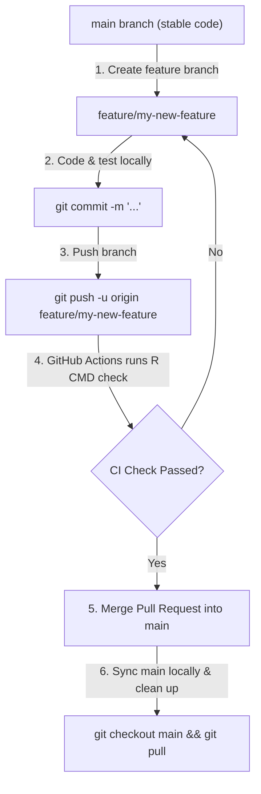

# ACRER: Accessibility Model for Urban Recreation

[](https://www.gnu.org/licenses/gpl-3.0.html)

**ACRER** (*Accessibility for Recreation in R*) is an R package implementing an optimization and simulation model for urban recreation accessibility. It models how different household types and group types distribute visits across surrounding destination recreation areas (such as forests, nature reserves, and parks) based on transport modes, travel costs, available time budgets, and spatial distance.

---

## 📌 Features

- **Spatial Accessibility Simulation**: Simulates recreational migration and demand from origin zip codes to destination areas.
- **Multi-Modal Transport Support**: Models travel behaviors across different transport modes (on foot, by bicycle, or by car).
- **Optimization Procedures**: Employs Linear and Quadratic Programming optimization (`quadprog`, interior-point method) for decision modeling across time segments and household constraints.
- **Embedded Database Engine**: Utilizes `RSQLite` and `sqldf` for fast querying of origin-destination matrices, activity patterns, and duration budgets.
- **Pivot Tables & Reporting**: Provides built-in cross-tabulation and pivot reporting utilities (`generate_pivot`, `percent_GT_pivot`).

---

## 🚀 Installation

You can install the latest version of `ACRER` directly from GitHub using `remotes` or `devtools`:

```r
# Install remotes if not already installed
if (!requireNamespace("remotes", quietly = TRUE)) {
  install.packages("remotes")
}

# Install ACRER from GitHub
remotes::install_github("martakis/ACRER")
```

---

## 💡 Quick Start

```r
library(ACRER)

# Run main ACRER model simulation
run_Acrer_model()

# Execute model SQL queries against SQLite dataset
Run_Queries()

# Generate summary pivot tables
generate_pivot()
```

---

## 📁 Package Structure & Datasets

- `R/`: Core R functions (`run_acrer_model`, `Run_Queries`, `generate_pivot`, `crosstab`, etc.).
- `inst/extdata/`: Bundled example datasets, SQLite databases (`Basic_Tables.db`), and RDS pivot files.
- `vignettes/`: Detailed documentation and supplementary materials (`ACRER_vignette.Rmd`).
- `tests/testthat/`: Unit tests verifying model calculations and cross-tabulations.

---

## 📖 Vignettes & Documentation

For a comprehensive guide on the model mathematical framework, database tables, and workflow, consult the package vignette:

```r
vignette("ACRER_vignette", package = "ACRER")
```

---

## 🌿 GitHub Branching Strategy

To keep the `main` branch stable and ensure all code passes `R CMD check` before being published, follow this Feature Branch workflow:

### Workflow Overview



---

### Step-by-Step Command Guide

#### Step 1: Start from an updated `main` branch
Always create new branches from an up-to-date `main` branch:
```bash
git checkout main
git pull origin main
git checkout -b feature/my-new-feature
```

#### Step 2: Develop, test, and commit your changes
Make your code changes, run tests locally, then stage and commit:
```bash
git status
git add .
git commit -m "Add new recreation analysis function and tests"
```

#### Step 3: Push your feature branch to GitHub
Push your branch to GitHub to trigger automated CI checks:
```bash
git push -u origin feature/my-new-feature
```

#### Step 4: Create a Pull Request (PR) on GitHub
1. Go to your repository on GitHub.
2. Click **Compare & pull request**.
3. Wait for the green **R-CMD-check** checkmark from GitHub Actions.
4. Click **Merge pull request** to integrate your code into `main`.

#### Step 5: Clean up your local environment
Once merged, return to `main`, pull the updated code, and delete the temporary branch:
```bash
git checkout main
git pull origin main
git branch -d feature/my-new-feature
```

---

## 📄 License

This package is licensed under the **GPL-2** license.

## 👤 Author

**Georgios Martakis**  
Email: [georgios.martakis@gmail.com](mailto:georgios.martakis@gmail.com)  
GitHub: [@martakis](https://github.com/martakis)
